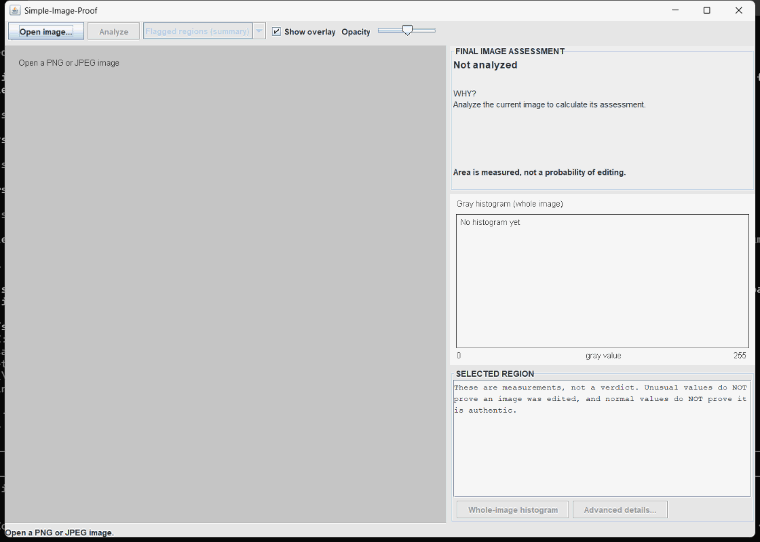

<h1 align="center">Simple-Image-Proof</h1>

<p align="center">
  A Java desktop app that looks at one image and points out areas that may have been edited.
</p>

<p align="center">
  
  
  
  
</p>

<p align="center">
  <a href="#demo">Demo</a> ·
  <a href="#quick-start">Quick start</a> ·
  <a href="#how-to-use">How to use</a> ·
  <a href="#how-it-works">How it works</a> ·
  <a href="#what-the-result-means">Result</a> ·
  <a href="docs/api/index.html">API docs</a> ·
  <a href="#team">Team</a>
</p>

---

Open one PNG or JPEG image and press **Analyze**. The app measures the image with
basic image processing (histograms, noise, edges and exact-copy search) and shows a
short result: a status, how much of the image looked unusual, and the reasons.

- **One image, nothing else.** No reference photo, no internet, no machine learning.
- **Short result.** A status, the anomalous area and up to three reasons.
- **Click any region.** See that region's own histogram and a short summary.
- **Several views.** Heatmap, noise, edges and copy-move, with an opacity slider.

> **Next read:** [docs/ARCHITECTURE.md](docs/ARCHITECTURE.md) explains the design, and
> [docs/report/REPORT.md](docs/report/REPORT.md) is the full report with tests and results.

## Demo

<p align="center">
  
</p>

<p align="center"><sub>More demos:
<a href="assets/gifs/histogram-and-regions.gif">histogram and regions</a> ·
<a href="assets/gifs/forensic-views.gif">forensic views</a></sub></p>

## Quick start

**You need:** JDK 17 or newer and Maven.

**Windows**

```bat
launcher.bat
```

**macOS / Linux**

```bash
./launcher.sh
```

Or run the steps yourself:

```bash
mvn -B clean test
mvn -B package -Dexec.skip=true
java -jar target/simple-image-proof-0.1.0.jar
```

## How to use

| To… | Do this |
|---|---|
| **Open an image** | Click **Open image...** and pick a PNG or JPEG (try `samples/copied.png`) |
| **Analyze it** | Click **Analyze** |
| **Read the result** | Look at the box at the top right: status, anomalous area, reasons |
| **Change the view** | Use the view list (flagged regions, variation, noise, edges, copy-move) |
| **Fade the overlay** | Move the **Opacity** slider, or untick **Show overlay** |
| **Check one region** | Click a tile on the image |
| **Go back to the whole image** | Click **Whole-image histogram** |
| **See all the numbers** | Click **Advanced details...** |

## How it works

```text
Open image → gray image → tiles (64 x 64) → measurements → result
```

| Check | What it looks for |
|---|---|
| **Histogram** | How the brightness values are spread, for the whole image and for each tile |
| **Noise** | Fine camera-like noise that is very different from the tiles around it |
| **Edges** | Strong outlines, so normal edges are not mistaken for edits |
| **Copy-move** | Two separate patches with exactly the same pixels (a clone stamp) |
| **Flat patch** | A solid colour area, like a Paint fill, in an otherwise noisy image |

More detail: [docs/ARCHITECTURE.md](docs/ARCHITECTURE.md) and the
[API docs](docs/JAVADOC.md).

## What the result means

| Status | Meaning |
|---|---|
| **Possible tampering indicators** | Something looked unusual. Worth a closer look. |
| **No notable indicators** | The checks found nothing. This does **not** prove the image is original. |
| **Inconclusive** | Not enough reliable information, for example a very small image. |

The **anomalous area** is the share of the image that met the rules
(`100 × flagged area ÷ analyzed area`). It is **not** the chance that the image was edited.

**This is a learning tool, not proof.** It misses many edits (for example a smoothly
brightened patch or a pasted object), and natural patterns can look suspicious.
Results and limits: [docs/EVALUATION.md](docs/EVALUATION.md).

## Where it helps

- Learning how histograms, noise and edges work.
- Practising media literacy: why unusual image patterns deserve a second look.
- Getting a first look at an image before a person inspects it closely.

## Project structure

```text
CSC360-Group2/
├── src/imageproof/        the application code
├── javatest/imageproof/   the tests
├── tools/imageproof/      helper programs (samples, benchmark, GIF recorder)
├── samples/               test images (gallery/ has the report images)
├── assets/                screenshots, diagrams and GIFs used by the docs
├── docs/                  documents, the API docs (api/) and the report (report/)
├── pom.xml                Maven build
└── launcher.bat / .sh     build and start in one step
```

## Testing

```bash
mvn -B clean test
```

This runs all tests without a window. The test for the real window needs a desktop and
is run separately; see [docs/MANUAL_TEST.md](docs/MANUAL_TEST.md). GitHub Actions runs
the tests on Java 17 for every push.

## Team

**CSC360 · Computer Graphics and Digital Image Processing · Monsoon 2026 · Group 2**

| No. | Name | Enrolment No. |
|:---:|:---|:---|
| 1 | Varun | AU2520215 |
| 2 | Satvik | AU2520039 |
| 3 | Garv | AU2520247 |
| 4 | Shambhavee | AU2500016 |

Topic assigned by Dhruvee Sheth. Ahmedabad University.

## More documents

[Architecture](docs/ARCHITECTURE.md) ·
[Evaluation](docs/EVALUATION.md) ·
[Final report](docs/report/REPORT.md) ·
[Manual test](docs/MANUAL_TEST.md) ·
[Java concepts](docs/JAVA_CONCEPTS.md) ·
[Project plan](docs/PROJECT_PLAN.md) ·
[Contributing](CONTRIBUTING.md)
