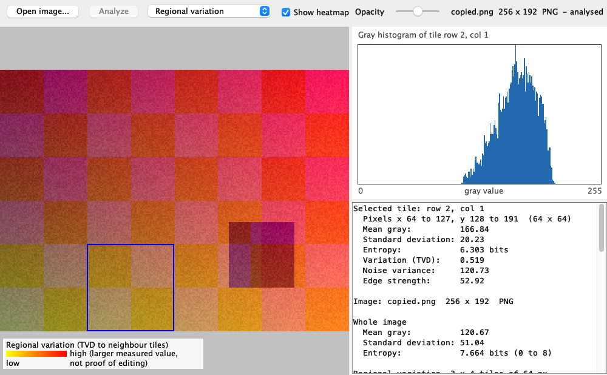
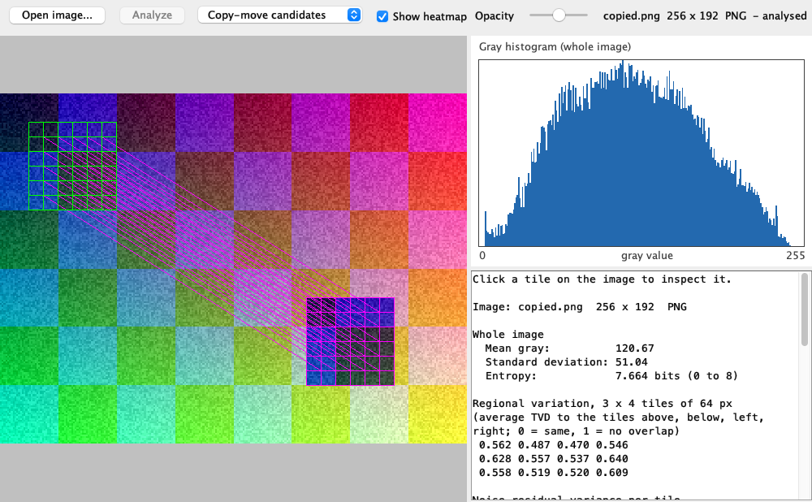

# Simple-Image-Proof

**CSC360 End-Semester Project | Group 2 | Ahmedabad University**

> **Assigned topic:** "Simple-Image-Proof: Simple check of Image Edits using a basic Histogram technique."

## What it does

Open **one** PNG or JPEG image and press **Analyze**. The program measures:

| Measurement | What it is |
| --- | --- |
| Global histogram | 256 bins of gray values, `gray = round(0.299 R + 0.587 G + 0.114 B)`, plus mean, standard deviation and entropy |
| Regional variation | Image split into 64 x 64 tiles. Each tile's histogram is compared with its 4 neighbours using total variation distance `TVD = 0.5 * sum(abs(p[i] - q[i]))` |
| Noise residual | Gray value minus the 3 x 3 local mean; variance per tile |
| Sobel edges | Edge strength `sqrt(gx² + gy²)` per pixel, mean per tile, and an edge map |
| Copy-move candidates | Exact 16 x 16 textured blocks that appear twice, far apart, with the same shift |

Results are shown as a heatmap on the image, a histogram and numbers. Click a tile to see its own histogram and values.





**This is an educational tool, not a forensic verdict.** Unusual numbers do not prove an image was edited, and normal numbers do not prove it is authentic. Object edges, texture, brightness changes, compression and repeated patterns all change these values. There is no threshold, probability or "edited / not edited" answer.

## Setup

Needs **JDK 17+** and **Maven**. No IDE and no extra libraries.

```bash
./launcher.sh
```

On Windows run `launcher.bat`. The launcher checks Java 17+ and Maven, rebuilds what changed, skips tests and starts the app.

Manual commands:

```bash
mvn test
```

```bash
mvn package -Dexec.skip=true
```

```bash
java -jar target/simple-image-proof-0.1.0.jar
```

`mvn test` runs every test headless (no window needed) and fails the build on any error. It also works from another folder (`mvn -f path/to/pom.xml test`). GitHub Actions runs it on Java 17 (Ubuntu and Windows) for every push and pull request.

## Usage

1. **Open image...** and pick a PNG or JPEG (up to 16 megapixels).
2. **Analyze**. Work runs in the background, the window stays responsive.
3. Choose a view: Regional variation, Noise residual variance, Edge strength, Edge map, Copy-move candidates.
4. Use **Show heatmap** and **Opacity** to see the image under the colours.
5. Click a tile to see its pixel range, histogram, mean, deviation, entropy, variation, noise and edge values.

Cancelling the file chooser keeps the current image. A broken or unsupported file shows an error and keeps the current image. Opening a new image clears the old results.

## Samples and results

`samples/` holds 12 synthetic files made by [`SampleGenerator`](tools/imageproof/SampleGenerator.java) (no outside photos): original, copied object (PNG and JPEG), inserted object, brightness, blur, shuffled pixels, repeated pattern, grayscale, transparent, corrupt and a text file. Measured results: [docs/EVALUATION.md](docs/EVALUATION.md) and [docs/RESULTS.csv](docs/RESULTS.csv).

## Code

| Class | Job |
| --- | --- |
| `Histogram` | gray values (gray images and transparency handled), counts, normalize, mean, std, entropy |
| `Comparison` | total variation distance |
| `Regions` | tiles, tile histograms, neighbour variation |
| `Noise`, `Edges`, `CopyMove` | the three diagnostics |
| `Analysis` | runs everything for one image |
| `LoadedImage` | reads a PNG/JPEG with clear errors |
| `App`, `ImagePanel`, `HistogramPanel` | the Swing window |

More: [Architecture](docs/ARCHITECTURE.md), [Manual test](docs/MANUAL_TEST.md), [Demo and presentation guide](docs/DEMO.md), [Java concepts](docs/JAVA_CONCEPTS.md), [Project plan](docs/PROJECT_PLAN.md).

## Limitations

- Histograms ignore pixel positions: `shuffled.png` has exactly the same global histogram as the original.
- Normal edges and texture give high variation, noise and edge values.
- Copy-move only finds exact copies moved by a multiple of 8 px, no rotation or scaling. Repeated patterns give false candidates. Big images are only partly searched (limit shown on screen).

## Team

**CSC360 — Group 2**: Satvik Patel, Varun, Garv, Shambhavee. **Topic assigned by:** Dhruvee Sheth.
