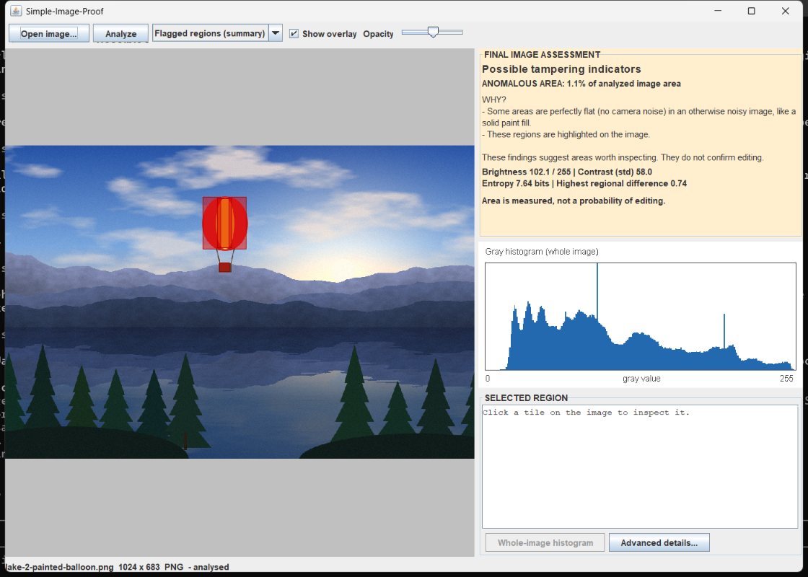
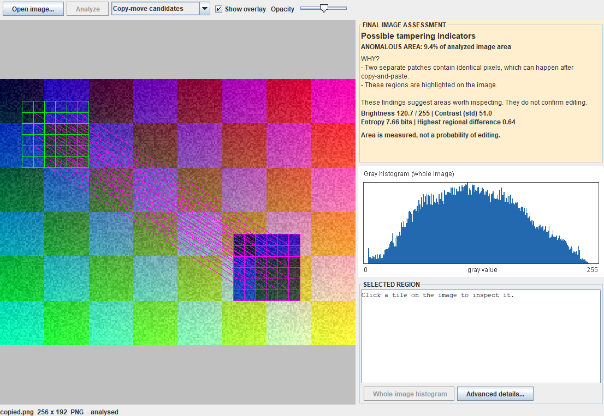

# Simple-Image-Proof

**CSC360 End-Semester Project | Group 2 | Ahmedabad University**

> **Assigned topic:** "Simple-Image-Proof: Simple check of Image Edits using a basic Histogram technique."

## What it does

Open **one** PNG or JPEG image and press **Analyze**. The program measures:

| Measurement | What it is |
| --- | --- |
| Global histogram | 256 bins of gray values, `gray = round(0.299 R + 0.587 G + 0.114 B)`, plus mean, standard deviation and entropy |
| Regional variation | Image split into 64 x 64 tiles. Each tile's histogram is compared with its 4 neighbours using total variation distance `TVD = 0.5 * sum(abs(p[i] - q[i]))` |
| Noise residual | Gray value minus the 3 x 3 local mean; variance per tile |
| Sobel edges | Edge strength `sqrt(gx² + gy²)` per pixel, mean per tile, and an edge map |
| Copy-move candidates | Exact 16 x 16 textured blocks that appear twice, far apart, with the same shift |

The result is a short **FINAL IMAGE ASSESSMENT**: a status, the **anomalous
area** as a percentage, at most three plain-language reasons and a note. Full
tables are kept out of the main window; **Advanced details...** shows them.

How it is decided (all from the single image, no reference image or online
database): a 64 x 64 tile is **flagged** when its histogram difference to its
neighbours is a high outlier *and* its noise differs from its neighbours, it is
not explained by a strong edge, and a neighbouring tile agrees. Two further
indicators are separate evidence: an exact copy-move patch pair, and a
solid-colour (flat) patch in an otherwise noisy PNG, like a Paint fill. Exact rules and thresholds:
[EVALUATION.md](docs/EVALUATION.md#final-assessment-rule).

- **Possible tampering indicators:** flagged tiles and/or a supported copy-move patch pair.
- **No notable indicators:** the tests found nothing. This does **not** mean the image is original or authentic.
- **Inconclusive:** not enough reliable information (tiny or uniform image, invalid data, repeated pattern, a copy-search limit).

**Anomalous area = 100 x flagged pixel area / analyzed pixel area.** It says how
much of the image met the rule. It is **not** a probability of forgery or editing;
no such probability is calculated (there is no calibration data).

**Full report with proof, screenshots and benchmark: [docs/REPORT.md](docs/REPORT.md).**



See [recorded desktop checks](docs/MANUAL_TEST.md#recorded-verification-local-anomaly-rule-and-concise-ui-2026-11-16).



**This is an educational tool, not a forensic verdict.** The heuristic describes
specific evidence and its limits; it is not a calibrated probability or a
definitive edited/unedited answer. Object boundaries, texture and repeated
patterns can respond strongly. A clear result does not establish authenticity.

## Setup

Needs **JDK 17+** and **Maven**. No IDE and no extra libraries.

```bash
./launcher.sh
```

On Windows run `launcher.bat`. The launcher checks Java 17+ and Maven, rebuilds what changed, skips tests and starts the app.

Manual commands:

```bash
mvn test
```

```bash
mvn package -Dexec.skip=true
```

```bash
java -jar target/simple-image-proof-0.1.0.jar
```

`mvn test` runs every test headless (no window needed) and fails the build on any error. It also works from another folder (`mvn -f path/to/pom.xml test`). GitHub Actions runs it on Java 17 (Ubuntu and Windows) for every push and pull request.

## Usage

1. **Open image...** and pick a PNG or JPEG (up to 16 megapixels).
2. **Analyze**. Work runs in the background, the window stays responsive.
3. Read the assessment. The first view highlights the flagged regions. Other views: Regional variation, Noise residual variance, Edge strength, Edge map, Copy-move candidates (flagged tiles stay outlined on the measurement maps).
4. Use **Show overlay** and **Opacity** to see the image under the colours.
5. Click a tile to see its histogram and a short summary (position, size, histogram difference, noise, edge strength). **Whole-image histogram** goes back.
6. **Advanced details...** opens the full tables, rule and copy-search counts.

Cancelling the file chooser keeps the current image. A broken or unsupported file shows an error and keeps the current image. Opening a new image clears the old results.

## Samples and results

`samples/` holds 12 synthetic files made by [`SampleGenerator`](tools/imageproof/SampleGenerator.java) (no outside photos): original, copied object (PNG and JPEG), inserted object, brightness, blur, shuffled pixels, repeated pattern, grayscale, transparent, corrupt and a text file. Measured results: [docs/EVALUATION.md](docs/EVALUATION.md) and [docs/RESULTS.csv](docs/RESULTS.csv).

## Code

| Class | Job |
| --- | --- |
| `Histogram` | gray values (gray images and transparency handled), counts, normalize, mean, std, entropy |
| `Comparison` | total variation distance |
| `Regions` | tiles, tile histograms, neighbour variation |
| `Noise`, `Edges`, `CopyMove` | the three diagnostics |
| `Analysis` | runs everything for one image |
| `LocalAnomaly` | flags tiles whose histogram and noise stand out from neighbours (edges explain, not vote) |
| `TamperingAssessment` | combines the local rule with the copy-move check; status, reasons, anomalous-area percentage |
| `LoadedImage` | reads a PNG/JPEG with clear errors |
| `App`, `ImagePanel`, `HistogramPanel` | the Swing window |

More: [Architecture](docs/ARCHITECTURE.md), [Manual test](docs/MANUAL_TEST.md), [Demo and presentation guide](docs/DEMO.md), [Java concepts](docs/JAVA_CONCEPTS.md), [Project plan](docs/PROJECT_PLAN.md).

## Limitations

- Histograms ignore pixel positions: `shuffled.png` has exactly the same global histogram as the original.
- Normal edges and texture give high variation, noise and edge values.
- The local rule sees regions whose histogram **and** noise both differ from their surroundings. It misses global changes (brightness, blur), shuffled pixels and flat inserted objects, and natural content can fire it. On a synthetic development/held-out benchmark it detected none of 80 local edits and 12 of 32 copy-moves, with no false warnings on 96 genuine images ([details](docs/EVALUATION.md#benchmark-with-development-and-held-out-scenes)).
- Copy-move only finds exact copies moved by a multiple of 8 px, no rotation or scaling. Repeated patterns give false candidates. Big images are only partly searched (limit shown on screen).

## Team

**CSC360 — Group 2**: Satvik Patel, Varun, Garv, Shambhavee. **Topic assigned by:** Dhruvee Sheth.
