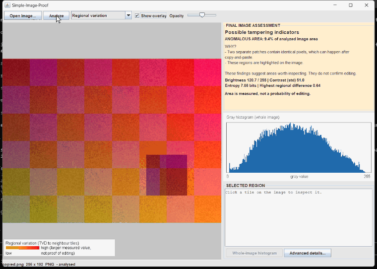
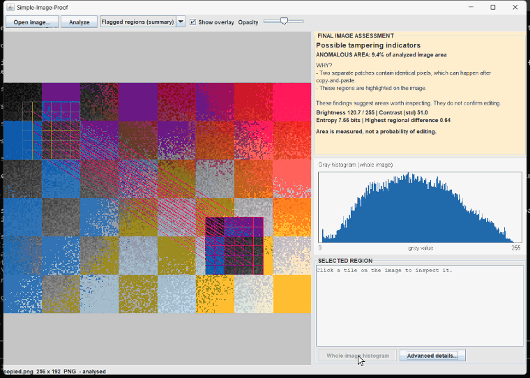

# Simple-Image-Proof

### Single-Image Forensic Analysis Using Java

**CSC360 End-Semester Project | Group 2 | Ahmedabad University**

A Java desktop application that examines **one image** using histograms and other
basic image-processing techniques, and highlights regions that look unusual.


*Real screen recording of the application: open a sample image, press Analyze, read the
assessment, the anomalous area and the short reasons.*

---

## Introduction

Digital images are easy to change. A region can be painted over, copied from one
place to another, or pasted from a different picture. Editing leaves small traces in
the pixels, such as unusual brightness distributions, missing camera noise or two
areas that are exactly equal.

Simple-Image-Proof shows how far **traditional image processing** can go in finding
such traces: no machine learning, no cloud service, no reference photograph. It is
an educational tool. It points at places a person should look at more closely. It
does **not** prove that an image is real or fake.

## Key features

| Feature | In simple words |
| --- | --- |
| One-image upload | Open one PNG or JPEG file (up to 16 megapixels). |
| Global histogram | Counts how many pixels have each gray value (0-255). |
| Regional histograms | Splits the image into 64 x 64 tiles and compares every tile with its neighbours. |
| Noise residual | Measures the fine, camera-like noise in each tile. |
| Sobel edges | Finds strong outlines so ordinary boundaries are not mistaken for edits. |
| Copy-move search | Finds two separate patches with exactly the same pixels (a clone stamp). |
| Flat-patch search | Finds solid-colour areas, like a Paint fill, in an otherwise noisy image. |
| Heatmap and overlays | Shows the measurements and the flagged regions on top of the image. |
| Final assessment | One of: *Possible tampering indicators*, *No notable indicators*, *Inconclusive*. |
| Anomalous-area percentage | How much of the image met the rules (a measured area, see below). |
| Click-a-region summary | Click a tile to see its own histogram and a short summary. |
| Advanced details | A separate window with the full tables, thresholds and search counts. |

## How it works

```text
Upload image
   -> Convert to grayscale
   -> Calculate image statistics (histogram, mean, contrast, entropy)
   -> Analyze local regions (tiles, noise, edges, copy-move, flat patches)
   -> Generate the flagged-region map
   -> Show the assessment, the anomalous area and up to three reasons
```

Everything is calculated from the single image you opened. The details and formulas
are in [docs/ARCHITECTURE.md](docs/ARCHITECTURE.md) and in the
[API reference](docs/JAVADOC.md).

**Anomalous area = 100 x flagged pixel area / analyzed pixel area.** It says how much
of the image met the rules. It is **not** the probability that the image was edited.

## Demonstrations

| Histogram and regions | Forensic views |
| --- | --- |
|  |  |
| The whole-image histogram, then one region's histogram and its short summary, then back. | Regional heatmap, noise, Sobel edge map and copy-move candidates, with the opacity slider. |

All three GIFs are recordings of the real window (real mouse movement and clicks) on the
synthetic sample `copied.png`. They are made with [`DemoGifs`](tools/imageproof/DemoGifs.java).

## Real-life applications and importance

The application is educational and investigative. It is useful for:

1. **Digital photography education.** See how image statistics change when a photo is modified.
2. **Media literacy.** Understand why unusual patterns in an image deserve a second look before it is trusted.
3. **Preliminary visual inspection.** Highlight regions for a human to examine more closely.
4. **Image-processing teaching and research.** A hands-on demo of histograms, spatial comparison, noise and edge detection.
5. **Quality-assurance demonstrations.** Study how compression and ordinary transformations affect pixel statistics.
6. **Digital forensics education.** Introduce basic passive-forensic ideas without claiming professional-grade evidence.

**What it is not.** It is not accepted as legal evidence, it cannot verify that a photograph is
authentic, and it cannot reliably find every manipulated image. A "no notable indicators"
result does not mean the image is original. It does not detect AI-generated images.

### Why this project is worthwhile

* Digital images are easy to alter, so knowing how to inspect them matters.
* Image analysis teaches useful maths: distributions, distances, gradients and local statistics.
* Different edits leave different traces in the pixels.
* A histogram alone loses *where* the pixels are, so local statistics add information.
* Several measurements need careful interpretation: edges and texture can look unusual without any edit.
* Understanding false warnings and missed detections is as important as finding something.

## Technology

Java 17, Java Swing, ImageIO, Maven and the standard Java libraries.
No machine learning, no cloud analysis and no external image-analysis APIs.

## Installation and running

You need a **JDK 17 or newer** and **Maven**.

```text
Windows:      launcher.bat
macOS/Linux:  ./launcher.sh
```

The launcher checks Java and Maven, builds what changed, skips the tests and starts the app.

Manual commands:

```bash
mvn -B clean test
mvn -B package -Dexec.skip=true
java -jar target/simple-image-proof-0.1.0.jar
```

## How to use

1. Click **Open image...** and choose a PNG or JPEG (try `samples/copied.png`).
2. Click **Analyze**. The work runs in the background, so the window stays responsive.
3. Read the **final assessment**, the **anomalous area** and the short reasons.
4. Use the view list to open the other views: regional variation, noise, edge strength, edge map and copy-move candidates. The **Opacity** slider fades the overlay.
5. Click a tile on the image to see its histogram and a short summary. **Whole-image histogram** goes back.
6. Click **Advanced details...** for the full numbers.

Opening a new image clears the old results. A broken or unsupported file shows an error and keeps the current image.

## Project structure

```text
CSC360-Group2/
├── src/imageproof/        application code (analysis classes and the Swing window)
├── javatest/imageproof/   Java tests (plain programs; AllTests runs them)
├── tools/imageproof/      helpers: sample generator, benchmark, gallery, GIF recorder
├── samples/               synthetic demonstration images made by the group
│   └── gallery/           the 11 colour test images used in the report
├── assets/                pictures used by the documents
│   ├── images/            screenshots and diagrams
│   ├── gifs/              the animated demos
│   └── report/            real-window screenshots for the final report
├── docs/                  documents (Markdown and CSV)
│   ├── api/               Javadoc API reference (open index.html)
│   └── report/            final report, benchmark tables, gallery results, test log
├── pom.xml                Maven build
└── launcher.bat / .sh     one-step build and start
```

## Testing

* `mvn -B clean test` runs the whole headless test suite (`javatest/imageproof/AllTests.java`). It also works from another folder: `mvn -f path/to/pom.xml test`.
* The tests are plain Java programs that stop with an error if a check fails. No JUnit is needed.
* `AssessmentGuiTest` tests the real window and needs a desktop, so it is run separately:

```bash
java -cp "target/classes:target/test-classes" -Dproject.dir=. imageproof.AssessmentGuiTest
```

On Windows use `;` instead of `:` in the class path.

* GitHub Actions runs the tests on Java 17 on Ubuntu and Windows for every push and pull request.

## Results and limitations

The tool was evaluated on synthetic images ([docs/EVALUATION.md](docs/EVALUATION.md),
[docs/report/REPORT.md](docs/report/REPORT.md)). In short:

* Copied regions are found when they are exact and on the 8-pixel grid; solid paint fills are found in noisy PNG images.
* Many manipulations are **missed**: smoothly brightened patches, pasted objects whose noise matches, rotated or re-compressed copies, global brightness or blur changes, and shuffled pixels.
* Naturally repeated patterns can cause false copy warnings, and flat areas in screenshots or JPEG files can look suspicious.
* "No notable indicators" is **not** proof of authenticity, and the anomalous-area percentage is measured area, **not** a probability of forgery.
* The evaluation is synthetic, so it does not show real-world accuracy.

## Team

**CSC360 - Group 2**: Satvik Patel, Varun, Garv, Shambhavee.
**Topic assigned by:** Dhruvee Sheth.

## Documentation

* [API reference (Javadoc)](docs/JAVADOC.md)
* [Architecture](docs/ARCHITECTURE.md)
* [Evaluation and known limitations](docs/EVALUATION.md) and the [final report](docs/report/REPORT.md)
* [Manual test guide](docs/MANUAL_TEST.md)
* [Java concepts used](docs/JAVA_CONCEPTS.md)
* [Project plan and decisions](docs/PROJECT_PLAN.md)
* [How to contribute](CONTRIBUTING.md)
