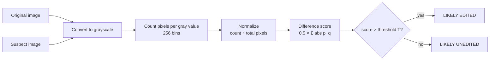
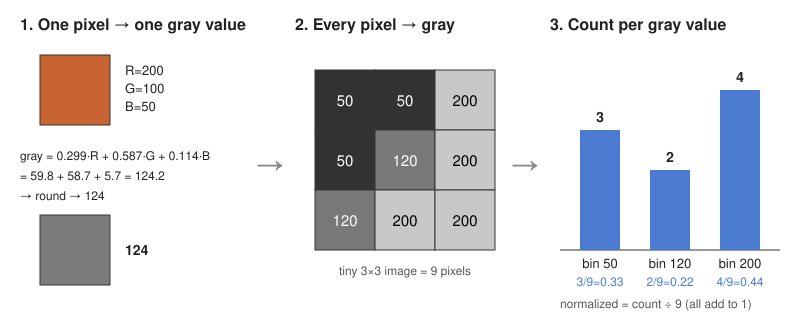
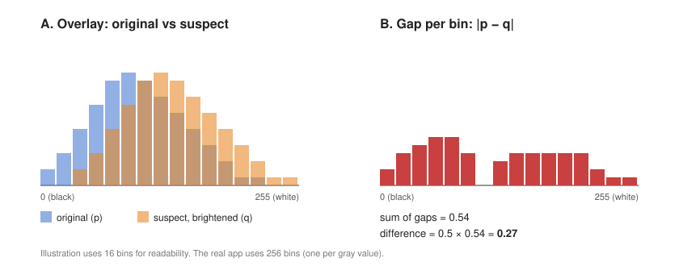
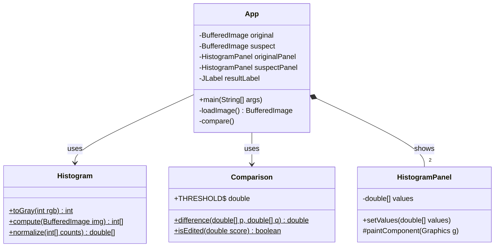
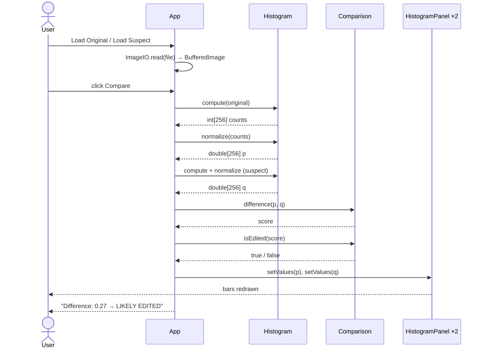
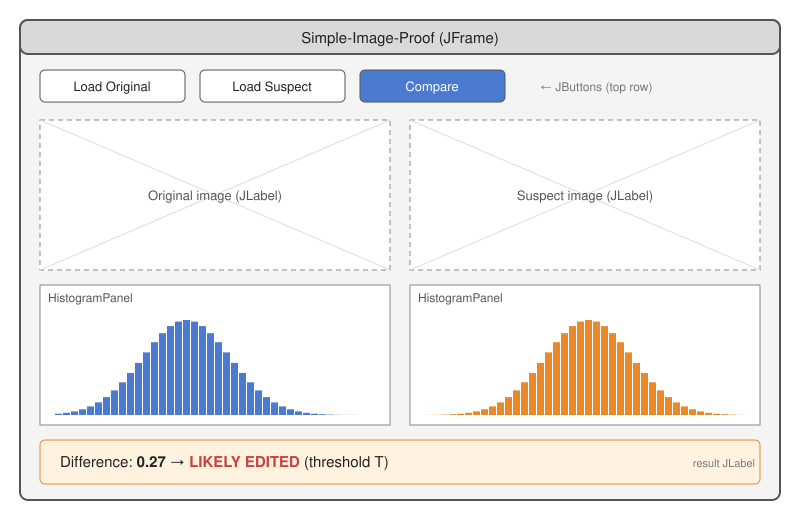
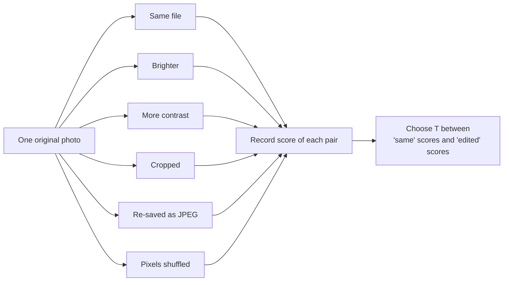
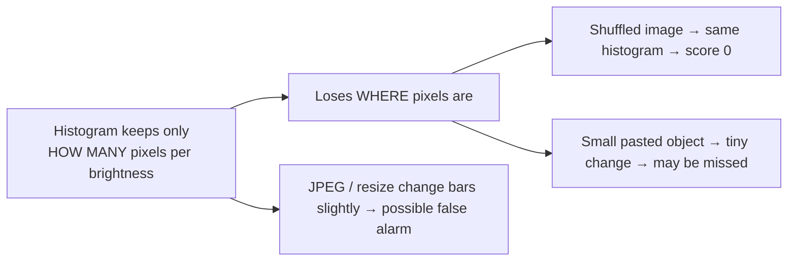

# Simple-Image-Proof — Architecture

**CSC360 · Group 2** · Minimal version: two images, one grayscale histogram each, one difference score.

> One-line idea: count how many pixels have each brightness (0–255) in both images, compare the counts, and report *similar* or *different*.

---

## 1. Big picture



The same steps run on **both** images. Only the last two boxes look at both together.

---

## 2. What happens to the pixels



| Step | Input | Output |
|---|---|---|
| Grayscale | pixel (R, G, B) | one number 0–255: `0.299R + 0.587G + 0.114B` |
| Histogram | all gray values | `int[256]` — `hist[v]` = how many pixels have gray value `v` |
| Normalize | `int[256]` | `double[256]` — each count ÷ total pixels; all values add up to 1 |

**Why normalize?** A 4000×3000 photo has far more pixels than a 400×300 copy. Dividing by the total turns counts into *fractions*, so image size stops mattering.

**Why these weights (0.299, 0.587, 0.114)?** Human eyes are most sensitive to green and least to blue. This is the standard luminance formula (ITU-R BT.601).

---

## 3. How two histograms are compared



```
difference = 0.5 × Σ |p[i] − q[i]|      for i = 0 … 255
```

- `p` = normalized histogram of original, `q` = of suspect.
- `|p[i] − q[i]|` = how far apart the two bars are at gray value `i` (red bars in panel B).
- Add all gaps, then halve → result always between **0** (identical histograms) and **1** (no overlap at all).
- Name of this measure: **total variation distance**.

**Verdict rule:** `difference > T` → "Likely edited". `T` is picked from our test results (section 7), not guessed.

---

## 4. Classes (only 4)



| Class | Job (one sentence) | Knows about Swing? |
|---|---|---|
| `Histogram` | Turns an image into a normalized 256-value array. | No |
| `Comparison` | Turns two arrays into a score and a yes/no verdict. | No |
| `HistogramPanel` | Draws one array as bars on screen. | Yes |
| `App` | Window, buttons, file loading; connects everything. | Yes |

**Design rule:** the math (`Histogram`, `Comparison`) never touches the UI. It can be tested alone, and explained alone.

---

## 5. What happens when you click "Compare"



---

## 6. Screen layout



One window (`JFrame`): button row on top, two image previews, two histogram panels, one result line.

---

## 7. Testing: how we pick threshold T



| # | Pair | Expected |
|---|---|---|
| 1 | Image vs itself | score = 0 |
| 2 | vs brighter copy | high score |
| 3 | vs higher contrast | high score |
| 4 | vs cropped | some score, depends on what was cut |
| 5 | vs JPEG re-save | small score — **not** an edit; T must sit above this |
| 6 | vs shuffled pixels | score = 0 — **limitation demo** |
| 7 | Non-image file | clear error message, no score |

Edits are made by hand in any image editor (e.g., GIMP / Preview) and saved in `samples/`.

---

## 8. What this method cannot do (we say this openly)



So the verdict means *"brightness distribution changed"*, not *"proof of forgery"*.

---

## 9. Files

```
CSC360-Group2/
├── src/imageproof/
│   ├── App.java             window + buttons + glue
│   ├── Histogram.java       gray, count, normalize
│   ├── Comparison.java      score + verdict
│   └── HistogramPanel.java  draws bars
├── samples/                 test images (original + edited copies)
└── docs/
    ├── ARCHITECTURE.md      this file
    ├── JAVA_CONCEPTS.md     Java topics needed
    └── images/              diagrams used here
```

Build & run (plain JDK 17, no libraries):

```bash
javac -d out src/imageproof/*.java
```

```bash
java -cp out imageproof.App
```
