# Simple-Image-Proof: Final Report

**CSC360 End-Semester Project | Group 2 | Ahmedabad University**

> One uploaded image in, one short, honest assessment out. No reference image, no
> database, no machine learning, no network.

---

## 1. Summary

| | |
|---|---|
| **What it does** | Looks at ONE PNG/JPEG with simple, explainable image maths (histograms, noise, edges, exact-copy search, flat-colour search) and reports a status, a **measured anomalous area** and at most three plain-language reasons. |
| **What the percentage means** | `100 x flagged pixel area / analyzed pixel area`. It is how much of the image met a rule. It is **not** a probability of forgery. |
| **Live proof (this report)** | On 11 new colour test images: both clean images stay at **0.0%**, **4 of 9 edits are detected**, **5 are missed** (and shown below, not hidden). |
| **Benchmark** | 288 synthetic images in separate development and held-out sets: **0 false warnings on 96 genuine images**, all Paint-style flat fills found, copy-move found when aligned to the 8 px grid. Brightness patches, pasted objects, global edits, shuffled pixels are **not** detected. |
| **Tests** | Every automated test passes (TamperingAssessmentTest 147, LocalAnomalyTest 34, FlatPatchTest 16, AssessmentGuiTest 23; 23 real-window checks). Java 17 CI on Ubuntu and Windows. |
| **Honest verdict** | A useful, transparent *screening aid* for crude edits (solid paint, clone-stamp). **Not** a forgery detector and **not** an AI-image detector. |

---

## 2. How it works

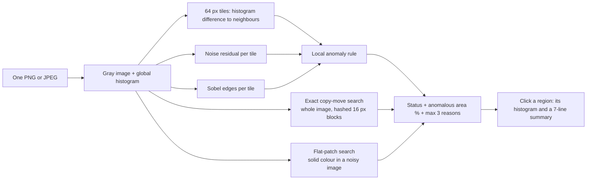

| Check | Idea in one sentence | Class |
|---|---|---|
| Regional histogram difference | A tile whose brightness distribution is an unusual outlier versus its neighbours. | `Regions`, `Comparison` |
| Noise residual | Camera noise should be similar nearby; large jumps can mean a region came from elsewhere. | `Noise` |
| Edges | Strong boundaries *explain* differences; they never add suspicion. | `Edges` |
| Local rule | Histogram **and** noise unusual in the same tile, not explained by an edge, with a flagged neighbour. | `LocalAnomaly` |
| Copy-move | Two separate patches with exactly equal pixels (clone stamp); all blocks are hashed so the **whole** image is searched. | `CopyMove` |
| Flat patch | A solid-colour area (like a Paint fill) in an image that is otherwise noisy; clipped 0/255 values, thin strokes, smooth ramps and JPEG files are excluded. | `FlatPatch` |

Status meanings: **Possible tampering indicators** (a rule fired), **No notable
indicators** (nothing fired; *not* proof of authenticity), **Inconclusive** (not
enough reliable information, for example a tiny image or a heavily repeated pattern).

---

## 3. Live proof on new colour test images

The two scenes are drawn by code ([`Gallery.java`](../../tools/imageproof/Gallery.java)): a
sunset mountain lake with clouds and reflections, and a meadow with a farmhouse,
fence and flowers, each with camera-style grain. They are not photographs and not
AI-generated. Edits mimic what people really do: paint a flat shape, clone-stamp a
region, paste a cut-out from another picture, dodge (brighten) a patch.

Every number below was produced by the real analysis ([`gallery-results.csv`](gallery-results.csv)).

| File | What was done | Result | Anomalous area | Outcome |
|---|---|---|---|---|
| `lake-1-original.png` | untouched | No notable indicators | 0.0% | **correct** |
| `lake-2-painted-balloon.png` | flat-colour balloon painted in the sky | Possible tampering indicators | 1.1% | **detected** |
| `lake-3-cloned-cloud.png` | cloud cloned (shift multiple of 8 px) | Possible tampering indicators | 4.6% | **detected** |
| `lake-4-cloned-cloud-offgrid.png` | cloud cloned (shift of -525 and +109 px is NOT a multiple of 8) | No notable indicators | 0.0% | **MISSED** |
| `lake-5-pasted-object.png` | soft-edged cut-out pasted from another image | No notable indicators | 0.0% | **MISSED** |
| `lake-6-brightened-patch.png` | feathered brightness patch | No notable indicators | 0.0% | **MISSED** |
| `meadow-1-original.png` | untouched | No notable indicators | 0.0% | **correct** |
| `meadow-2-painted-balloon.png` | flat-colour balloon painted in the sky | Possible tampering indicators | 1.1% | **detected** |
| `meadow-3-cloned-house.png` | house cloned next to itself (shift multiple of 8 px) | Possible tampering indicators | 17.0% | **detected** |
| `meadow-4-pasted-object.png` | soft-edged cut-out pasted from another image | No notable indicators | 0.0% | **MISSED** |
| `meadow-5-brightened-patch.png` | feathered brightness patch | No notable indicators | 0.0% | **MISSED** |

### 3.1 Clean image: nothing flagged

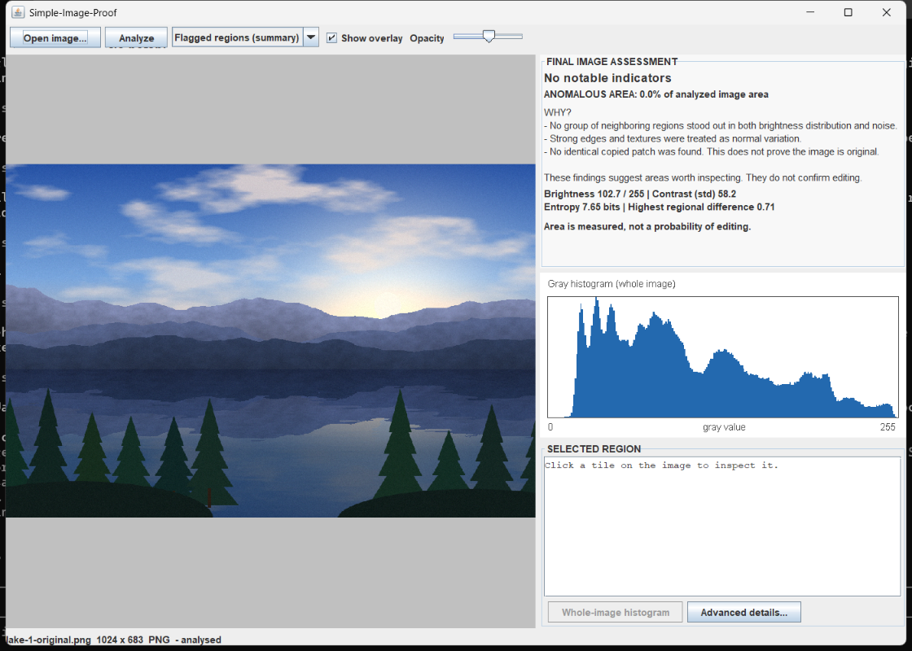

### 3.2 Painted balloon: detected

A flat-colour balloon drawn over the sky has *no camera grain*. The flat-patch
rule finds it and the overlay marks it. (Area is small, 1.1%, because only the
balloon's solid pixels count.)

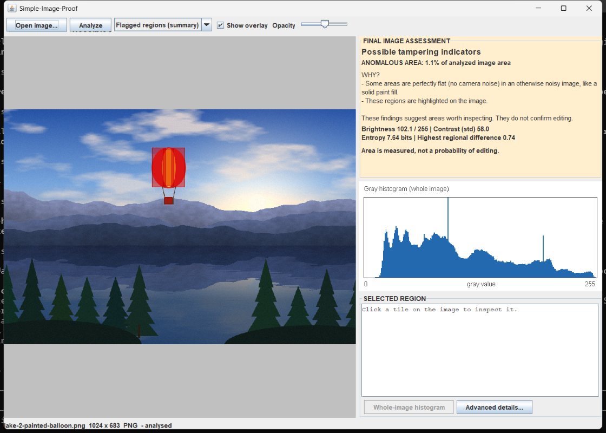

### 3.3 Clone-stamped cloud: detected

A cloud was copied elsewhere in the sky. The detector finds 220 pairs of exactly
equal blocks that share one shift and draws source (green) and copy (magenta).

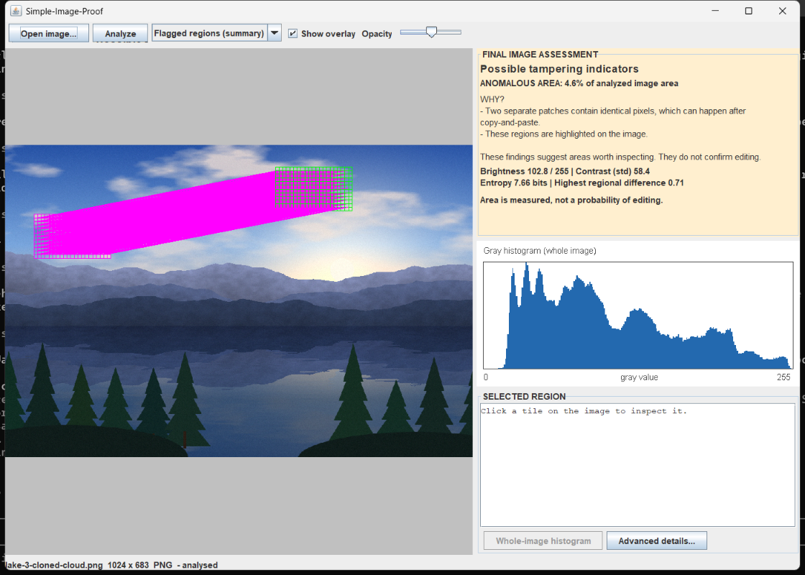

### 3.4 Cloned house: detected

The whole farmhouse was cloned next to itself (868 matching block pairs, 17.0% of the area).

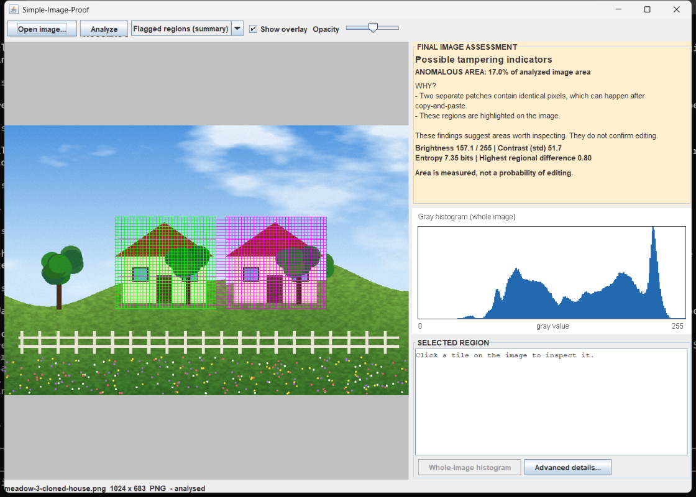

### 3.5 Painted balloon on a second scene: detected

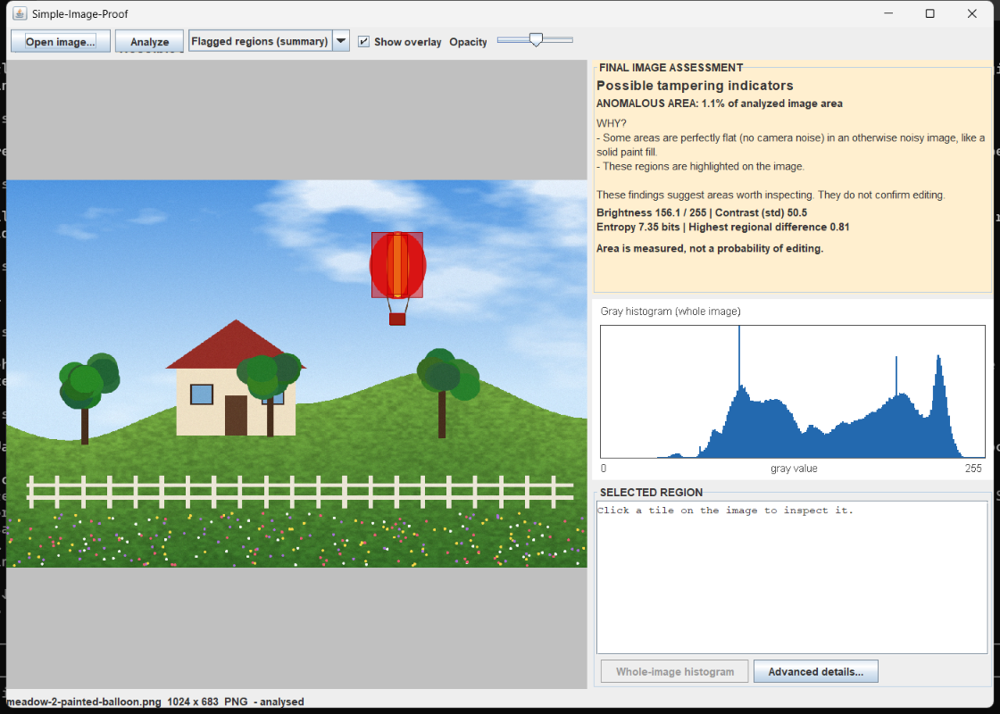

### 3.6 Misses, shown honestly

**A soft-edged object pasted from another picture** is *not* flagged: after
pasting, its grain matches the surroundings, so none of the rules see a
difference.

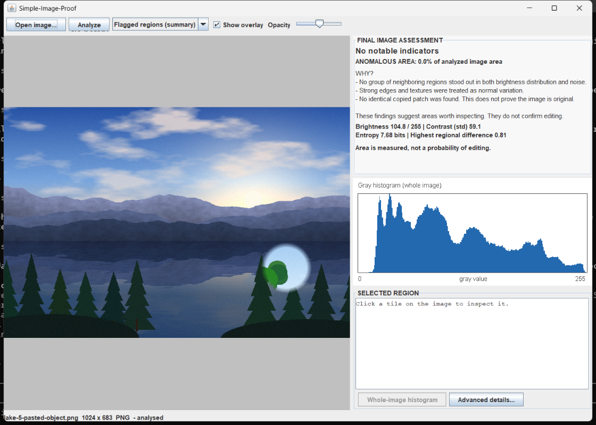

**A feathered brightness patch** is *not* flagged: a smoothly lightened area looks
exactly like natural lighting or a shadow from one image alone.

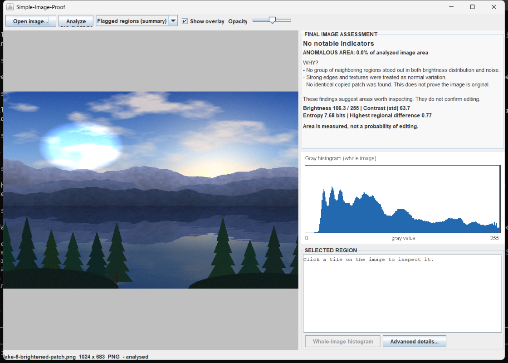

**A clone whose shift is not a multiple of 8 px** is also missed
(`lake-4-cloned-cloud-offgrid.png`): exact block matching only works on the 8 px grid.

### 3.7 Selecting a region, minimum window size, Advanced details

Clicking a tile shows its own histogram and a short summary; the assessment above
does not change. The window stays usable at its minimum size (920 x 700).

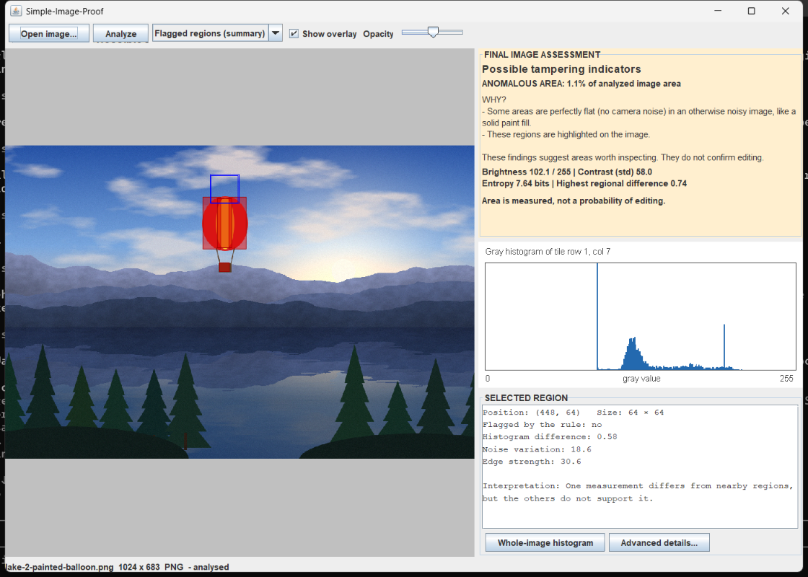
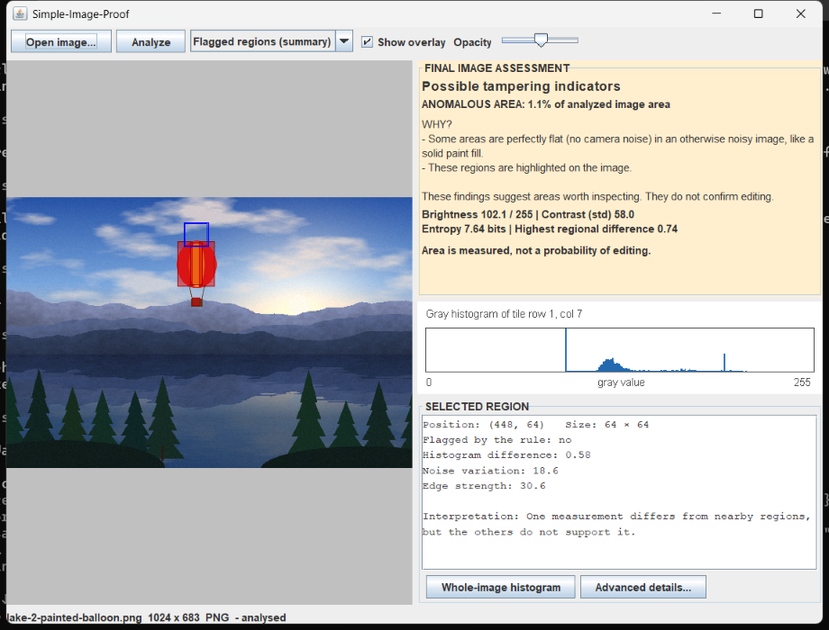
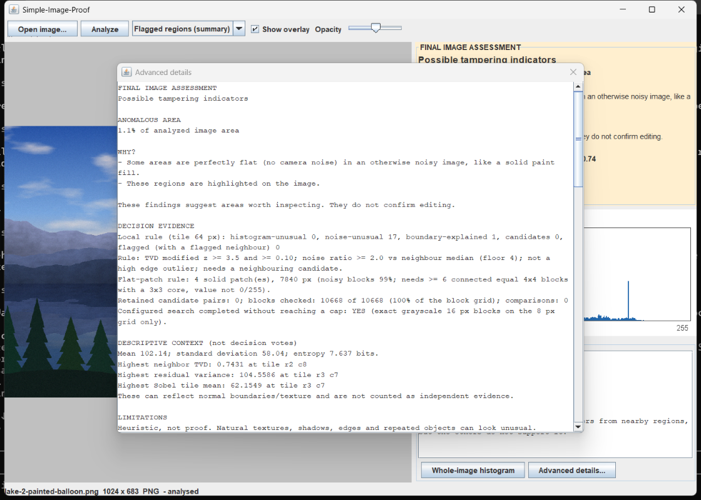

---

## 4. Independent benchmark (development vs held-out)

`Benchmark.java` builds scenes with their own seeds. Development scenes (seeds
1000-1006) were used to examine rules; held-out scenes (seeds 5000-5008, including
two scene families never seen in development) were only run to report results.
Edits of one scene never appear in the other group, so nothing leaks.

### Development set (126 images, 7 scenes)

| Truth | Edit | Images | Possible | No notable | Inconclusive | Mean area when flagged |
|---|---|---|---|---|---|---|
| genuine | original scene | 7 | 0 | 7 | 0 | - |
| genuine | re-save / format / size | 28 | 0 | 26 | 2 | - |
| local-edit | insert-object | 7 | 0 | 7 | 0 | - |
| local-edit | brightness-patch+45 | 7 | 0 | 7 | 0 | - |
| local-edit | brightness-patch-45 | 7 | 0 | 7 | 0 | - |
| local-edit | paint-fill-rect | 7 | 7 | 0 | 0 | 3.9% |
| local-edit | paint-fill-ellipse | 7 | 7 | 0 | 0 | 3.1% |
| local-edit | paint-scribble | 7 | 0 | 7 | 0 | - |
| copy-move | copy-move-grid | 7 | 5 | 1 | 1 | 6.6% |
| copy-move | copy-move-offgrid | 7 | 0 | 7 | 0 | - |
| global-edit | global-brightness+40 | 7 | 0 | 7 | 0 | - |
| global-edit | global-blur | 7 | 0 | 7 | 0 | - |
| genuine | small 160x120 original | 7 | 0 | 0 | 7 | - |
| local-edit | small 160x120 edits | 14 | 0 | 0 | 14 | - |

Slowest analysis 128 ms, median 41 ms; copy-search coverage 100% for all images.

### Held-out set (162 images, 9 scenes)

| Truth | Edit | Images | Possible | No notable | Inconclusive | Mean area when flagged |
|---|---|---|---|---|---|---|
| genuine | original scene | 9 | 0 | 9 | 0 | - |
| genuine | re-save / format / size | 36 | 0 | 34 | 2 | - |
| local-edit | insert-object | 9 | 0 | 9 | 0 | - |
| local-edit | brightness-patch+45 | 9 | 0 | 9 | 0 | - |
| local-edit | brightness-patch-45 | 9 | 0 | 9 | 0 | - |
| local-edit | paint-fill-rect | 9 | 9 | 0 | 0 | 4.3% |
| local-edit | paint-fill-ellipse | 9 | 9 | 0 | 0 | 3.4% |
| local-edit | paint-scribble | 9 | 0 | 9 | 0 | - |
| copy-move | copy-move-grid | 9 | 7 | 1 | 1 | 7.0% |
| copy-move | copy-move-offgrid | 9 | 0 | 9 | 0 | - |
| global-edit | global-brightness+40 | 9 | 0 | 9 | 0 | - |
| global-edit | global-blur | 9 | 0 | 9 | 0 | - |
| genuine | small 160x120 original | 9 | 0 | 0 | 9 | - |
| local-edit | small 160x120 edits | 18 | 0 | 0 | 18 | - |

Slowest analysis 651 ms, median 40 ms; copy-search coverage 100% for all images.


**Reading the numbers honestly**

* **0 false warnings on 96 genuine images** (originals, JPEG re-saves, gray, transparent corner, small versions, natural repeats, smooth sky, text). Some are *Inconclusive*: small images (too few tiles) and JPEG q40.
* **Paint-style fills: all found** (rect and ellipse). **Brush strokes and text are not**, by design: thin shapes can't be told from text.
* **Copy-move: found when the shift is a multiple of 8 px; missed otherwise.**
* **Brightness patches, pasted objects, global brightness, global blur: never detected.** These are indistinguishable from natural lighting, compositing or a different exposure when looking at a single image.
* The benchmark and the gallery are **synthetic**. They show how the rules behave, **not** real-world accuracy.

---

## 5. What was built and changed

| Step | What | Where |
|---|---|---|
| Final assessment | Status, reasons, anomalous-area percentage, short UI, Advanced details window | PR #41 (merged, issue #40 closed) |
| Local anomaly rule | Histogram + noise + neighbour agreement, edges explain, never vote | `LocalAnomaly` |
| Large-image coverage | Hash-based copy search; whole block grid searched; coverage reported (12 MP in 5.2 s, 146 MB heap) | PR #42 |
| Clone cap fix | A legitimate clone larger than 200 pairs used to look like a repeated pattern; cap raised to 2000 (found with this report's gallery) | PR #42 |
| Flat-patch indicator | Paint-style solid fills in noisy PNGs | PR #42 |
| Benchmark and gallery | Development/held-out sets, colour gallery, per-image CSVs | `tools/imageproof/`, `docs/` |

Things that were tried and **rejected** on development data (and why): lowering the
z-score (+1 false warning, no gain), histogram-only rule (1 false warning),
histogram-or-noise rule (flags 18 of 30 genuine images), and an adaptive 32 px tile
for small images (0 of 14 small edits detected, would turn honest "Inconclusive"
into misleading "No notable indicators").

---

## 6. Verification and proof

| Item | Result |
|---|---|
| `mvn -B clean test` | Passed. Log: [`test-log.txt`](test-log.txt) |
| `mvn -B package -Dexec.skip=true` | BUILD SUCCESS, jar built |
| Test programs | Histogram, Comparison, Analysis, HistogramPanel, Regions, NoiseEdges, CopyMove, ImagePanel, Samples (all OK) |
| `TamperingAssessmentTest` | 147 |
| `LocalAnomalyTest` | 34 |
| `FlatPatchTest` | 16 |
| `AssessmentGuiTest` | 23 |
| `AssessmentGuiTest` (real window) | 23 checks passed |
| Real desktop screenshots | 10 in this folder, inspected by eye: assessment, overlay, region summary, minimum size, Advanced details |
| Opacity 0/25/50/75/100% | Pixel in a flagged tile read 121,121,121 / 145,91,91 / 171,61,61 / 195,30,30 / 220,0,0 ([MANUAL_TEST.md](../MANUAL_TEST.md)) |
| Large image (4000 x 3000) | 100% copy-search coverage, 5.2 s, 146 MB heap, worst UI delay 42 ms |
| Stale-result protection | Forced out-of-order worker completion: old results never appear for a new image |
| CI | GitHub Actions, Temurin 17, Ubuntu and Windows (green on every merged head) |

**Not verified (stated plainly):** a real screen reader; a real file-chooser dialog
(the same load method was called directly); Linux/macOS desktops for this version;
local runs used JDK 24 compiled for Java 17 (no local JDK 17), CI used real Java 17.

---

## 7. Limitations

| Limitation | Class | Detail |
|---|---|---|
| Brightness patch, feathered edit | Fundamental | Looks like a shadow or light; no reference in one image. |
| Pasted object with matching grain | Fundamental for these tools | Nothing local differs after pasting. |
| Global brightness / blur | Fundamental | A darker or blurrier photo is valid. |
| Shuffled pixels | Fundamental for this method | Histogram ignores position. |
| Natural identical motifs | Fundamental | Identical pixels look the same whether copied or naturally repeated; many matches stay *Inconclusive*. |
| AI-generated images | Out of scope | A generated image is consistent everywhere: **0%** is expected. No reliable simple pixel method exists; a provenance-metadata reader would be the only defensible addition. |
| Off-grid, rotated, scaled, recompressed copies | Improvable, costly | Exact matching needs an 8 px aligned shift. |
| Flat patches in JPEG files | Excluded | JPEG creates flat areas by itself; the rule is off for JPEG input. A PNG that was once a JPEG, or a noise-free screenshot with flat panels, can still give a false warning. |
| Small images (< about 192 x 192) | Inconclusive | Too few tiles for local comparison. |
| Thresholds | Weakly validated | Chosen as round values before measuring and checked only on synthetic data. No accuracy figure is claimed. |

---

## 8. Reproduce everything

```bash
mvn -B clean test
mvn -B package -Dexec.skip=true
java -jar target/simple-image-proof-0.1.0.jar
```

```powershell
# regenerate the gallery and its results
java -cp 'target/classes;target/test-classes' imageproof.Gallery samples/gallery
# regenerate the benchmark tables
java -cp 'target/classes;target/test-classes' imageproof.Benchmark dev docs/BENCHMARK_DEV.csv
java -cp 'target/classes;target/test-classes' imageproof.Benchmark held-out docs/BENCHMARK_HELDOUT.csv
# real-window test (needs a desktop)
java -cp 'target/classes;target/test-classes' imageproof.AssessmentGuiTest
```

## 9. Files in this folder

| Path | Content |
|---|---|
| `../../samples/gallery/*.png` | The 11 colour test images (2 clean, 9 edited) |
| `gallery-results.csv` | Real analysis result per image |
| `../../assets/report/gui-*.png` | Real-window screenshots |
| `benchmark-tables.md` | Benchmark tables (generated from the CSVs) |
| `test-log.txt` | Test, build and GUI-test output |
| `../BENCHMARK_DEV.csv`, `../BENCHMARK_HELDOUT.csv` | One row per benchmark image |
| `../EVALUATION.md`, `../MANUAL_TEST.md`, `../ARCHITECTURE.md` | Detailed method, manual checks and design |

*This tool describes measurable image properties and where they look unusual. It
cannot prove that an image is authentic or forged.*
